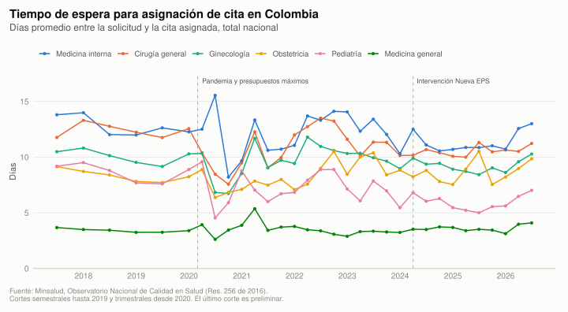
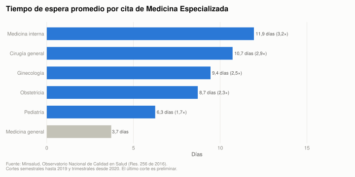

Gráficas elaboradas con datos públicos y reportes oficiales. El código fuente está en el
[repositorio](https://github.com/jujgomezru/MSD_application) y las fuentes, en `data/fuentes.csv`.

## Espera por departamento

```{ojs}
//| echo: false
P = import("https://cdn.jsdelivr.net/npm/@observablehq/plot@0.6.17/+esm")

geo = FileAttachment("data/geo/departamentos.geojson").json()

datos = FileAttachment("data/processed/mapa_espera_departamentos.csv").csv()
  .then(filas => filas.map(d => ({
    ...d,
    dias: d.dias === "" ? null : +d.dias,
    citas: +d.citas,
    promedio_nacional: +d.promedio_nacional
  })))

orden = ["Medicina general", "Medicina interna", "Cirugía general", "Ginecología", "Obstetricia", "Pediatría"]

viewof especialidad = Inputs.select(orden, {label: "Especialidad", value: "Medicina general"})
```

```{ojs}
//| echo: false
fmt = x => x.toLocaleString("es-CO", {minimumFractionDigits: 1, maximumFractionDigits: 1})
mes = d => new Date(d + "T00:00:00").toLocaleDateString("es-CO", {month: "long", year: "numeric"})

seleccion = datos.filter(d => d.especialidad === especialidad && d.dias !== null)
media = seleccion[0].promedio_nacional
porCodigo = new Map(seleccion.map(d => [d.cod_depto, d]))

// La escala pivota en el promedio nacional: verde por debajo, rojo por encima.
dominio = {
  const valores = seleccion.map(d => d.dias);
  return [Math.min(...valores, media - 0.01), media, Math.max(...valores, media + 0.01)];
}

md`Promedio nacional: **${fmt(media)} días**. Los departamentos en verde asignan citas más rápido
que el promedio y los rojos, más lento. Días promedio entre la solicitud y la cita asignada,
${mes(seleccion[0].desde.slice(0, 7) + "-01")} a ${mes(seleccion[0].hasta)}, ponderado por número de citas.`
```

```{ojs}
//| echo: false
mapa = P.plot({
  width: 640,
  projection: {type: "mercator", domain: geo},
  color: {
    type: "linear",
    domain: dominio,
    range: ["#1b7837", "#f0efec", "#b2182b"],
    label: "Días de espera",
    tickFormat: fmt
  },
  marks: [
    P.geo(geo, {fill: "#e1e0d9", stroke: "#fcfcfb", strokeWidth: 0.8}),
    P.geo(geo, P.centroid({
      filter: f => porCodigo.has(f.properties.DPTO_CCDGO),
      // El filtro se aplica después de evaluar los canales: de ahí el ?.
      fill: f => porCodigo.get(f.properties.DPTO_CCDGO)?.dias,
      stroke: "#fcfcfb",
      strokeWidth: 0.8,
      title: f => {
        const d = porCodigo.get(f.properties.DPTO_CCDGO);
        if (!d) return null;
        const diferencia = d.dias - media;
        return `${d.departamento}\n${fmt(d.dias)} días ` +
          `(${diferencia >= 0 ? "+" : "−"}${fmt(Math.abs(diferencia))} frente al promedio)\n` +
          `${d.citas.toLocaleString("es-CO")} citas`;
      },
      tip: true
    }))
  ]
})

html`${mapa.legend("color", {marginLeft: 16, width: 360, tickFormat: fmt})}${mapa}`
```

<p class="nota-fuente">Fuente: Minsalud, Observatorio Nacional de Calidad en Salud (Res. 256 de 2016);
límites departamentales: DANE, Marco Geoestadístico Nacional 2025. Los departamentos en gris no tienen
datos para la especialidad. En departamentos con pocas citas el promedio es menos estable.</p>

```{ojs}
//| echo: false
Inputs.table(
  seleccion.map(d => ({
    Departamento: d.departamento,
    "Días": d.dias,
    "Frente al promedio": d.dias - media,
    Citas: d.citas
  })),
  {
    sort: "Días",
    reverse: true,
    rows: 12,
    format: {
      "Días": fmt,
      "Frente al promedio": x => (x >= 0 ? "+" : "−") + fmt(Math.abs(x)),
      Citas: x => x.toLocaleString("es-CO")
    }
  }
)
```

## Especialistas por departamento

```{ojs}
//| echo: false
especialistas = FileAttachment("data/processed/mapa_especialistas_departamentos.csv").csv()
  .then(filas => filas.map(d => ({
    ...d,
    profesionales: +d.profesionales,
    poblacion: +d.poblacion,
    por_100k: +d.por_100k,
    tasa_nacional: +d.tasa_nacional
  })))

ordenPerfiles = ["Medicina interna", "Cirugía general", "Ginecología y obstetricia", "Pediatría", "Médicos (pregrado)"]

viewof perfil = Inputs.select(ordenPerfiles, {label: "Especialidad", value: "Medicina interna"})
```

```{ojs}
//| echo: false
seleccionEsp = especialistas.filter(d => d.especialidad === perfil)
tasaNacional = seleccionEsp[0].tasa_nacional
porCodigoEsp = new Map(seleccionEsp.map(d => [d.cod_depto, d]))

// Pivote en la tasa nacional: verde por encima (más especialistas), rojo por debajo.
dominioEsp = {
  const valores = seleccionEsp.map(d => d.por_100k);
  return [Math.min(...valores, tasaNacional - 0.01), tasaNacional, Math.max(...valores, tasaNacional + 0.01)];
}

md`Tasa nacional: **${fmt(tasaNacional)} por cada 100.000 habitantes**. Los departamentos en verde
tienen más profesionales por habitante que el promedio nacional y los rojos, menos.`
```

```{ojs}
//| echo: false
mapaEsp = P.plot({
  width: 640,
  projection: {type: "mercator", domain: geo},
  color: {
    type: "linear",
    domain: dominioEsp,
    range: ["#b2182b", "#f0efec", "#1b7837"],
    label: "Profesionales por 100.000 habitantes",
    tickFormat: fmt
  },
  marks: [
    P.geo(geo, P.centroid({
      fill: f => porCodigoEsp.get(f.properties.DPTO_CCDGO)?.por_100k,
      stroke: "#fcfcfb",
      strokeWidth: 0.8,
      title: f => {
        const d = porCodigoEsp.get(f.properties.DPTO_CCDGO);
        if (!d) return null;
        return `${d.departamento}\n${fmt(d.por_100k)} por 100.000 habitantes\n` +
          `${d.profesionales.toLocaleString("es-CO")} profesionales registrados`;
      },
      tip: true
    }))
  ]
})

html`${mapaEsp.legend("color", {marginLeft: 16, width: 360, tickFormat: fmt})}${mapaEsp}`
```

<p class="nota-fuente">Fuente: Minsalud, Registro Único Nacional del Talento Humano en Salud (ReTHUS),
corte 2022, por departamento de residencia; población: DANE, proyecciones 2022. ReTHUS es acumulado:
incluye profesionales que pudieron retirarse, fallecer o mudarse, así que sirve para comparar
departamentos, no como conteo exacto. Cundinamarca aparece baja porque muchos profesionales que
trabajan allí residen en Bogotá. "Médicos (pregrado)" incluye a todos los títulos de medicina, también
a quienes luego se especializaron.</p>

```{ojs}
//| echo: false
Inputs.table(
  seleccionEsp.map(d => ({
    Departamento: d.departamento,
    "Por 100.000 hab.": d.por_100k,
    Profesionales: d.profesionales,
    "Población": d.poblacion
  })),
  {
    sort: "Por 100.000 hab.",
    reverse: true,
    rows: 12,
    format: {
      "Por 100.000 hab.": fmt,
      Profesionales: x => x.toLocaleString("es-CO"),
      "Población": x => x.toLocaleString("es-CO")
    }
  }
)
```

## Citas por habitante y tiempo de espera

```{ojs}
//| echo: false
percapita = FileAttachment("data/processed/citas_per_capita_departamentos.csv").csv()
  .then(filas => filas.map(d => ({
    ...d,
    citas: +d.citas,
    poblacion: +d.poblacion,
    citas_por_1000: +d.citas_por_1000,
    dias: +d.dias,
    citas_por_1000_nacional: +d.citas_por_1000_nacional,
    promedio_nacional: +d.promedio_nacional
  })))

viewof especialidadPc = Inputs.select(orden, {label: "Especialidad", value: "Medicina interna"})
```

```{ojs}
//| echo: false
seleccionPc = percapita.filter(d => d.especialidad === especialidadPc)
citasNac = seleccionPc[0].citas_por_1000_nacional
diasNac = seleccionPc[0].promedio_nacional

// Se rotulan los departamentos más grandes y los más alejados del promedio.
rotulados = new Set([
  ...[...seleccionPc].sort((a, b) => b.poblacion - a.poblacion).slice(0, 4),
  ...[...seleccionPc].sort((a, b) => a.citas_por_1000 - b.citas_por_1000).slice(0, 4),
  ...[...seleccionPc].sort((a, b) => b.dias - a.dias).slice(0, 3)
].map(d => d.departamento))

md`Cada punto es un departamento; su tamaño indica la población. Las líneas marcan los valores
nacionales: **${fmt(citasNac)} citas por cada 1.000 habitantes** y **${fmt(diasNac)} días** de espera.
Abajo a la izquierda están los departamentos con pocas citas por habitante y espera corta: allí la
espera corta puede reflejar poca oferta local y no buen acceso.`
```

```{ojs}
//| echo: false
P.plot({
  width: 720,
  height: 480,
  marginRight: 20,
  grid: true,
  x: {label: "Citas asignadas por cada 1.000 habitantes →", tickFormat: fmt},
  y: {label: "↑ Días de espera", tickFormat: fmt, zero: true},
  r: {range: [3, 22]},
  marks: [
    P.ruleX([citasNac], {stroke: "#898781", strokeDasharray: "4,3"}),
    P.ruleY([diasNac], {stroke: "#898781", strokeDasharray: "4,3"}),
    P.text(["Menos citas, más espera"], {frameAnchor: "top-left", dx: 6, dy: 6, fill: "#52514e", fontSize: 11}),
    P.text(["Más citas, más espera"], {frameAnchor: "top-right", dx: -6, dy: 6, fill: "#52514e", fontSize: 11}),
    P.text(["Menos citas, menos espera"], {frameAnchor: "bottom-left", dx: 6, dy: -6, fill: "#52514e", fontSize: 11}),
    P.text(["Más citas, menos espera"], {frameAnchor: "bottom-right", dx: -6, dy: -6, fill: "#52514e", fontSize: 11}),
    P.dot(seleccionPc, {
      x: "citas_por_1000",
      y: "dias",
      r: "poblacion",
      fill: "#2a78d6",
      fillOpacity: 0.7,
      stroke: "#fcfcfb",
      strokeWidth: 1,
      title: d => `${d.departamento}\n${fmt(d.citas_por_1000)} citas por 1.000 habitantes\n` +
        `${fmt(d.dias)} días de espera\n${d.citas.toLocaleString("es-CO")} citas en el periodo`,
      tip: true
    }),
    P.text(seleccionPc.filter(d => rotulados.has(d.departamento)), {
      x: "citas_por_1000",
      y: "dias",
      text: d => d.departamento.replace("Archipiélago de San Andrés, Providencia y Santa Catalina", "San Andrés"),
      dy: -12,
      fontSize: 10,
      fill: "#0b0b0b"
    })
  ]
})
```

<p class="nota-fuente">Fuente: Minsalud, Observatorio Nacional de Calidad en Salud (Res. 256 de 2016),
julio de 2025 a junio de 2026; población: DANE, proyecciones (promedio 2025-2026). Las citas se cuentan
en el departamento de la IPS que atiende, no en el de residencia del paciente, y dependen de la
cobertura del reporte de cada departamento.</p>

## Lo que el indicador no ve: reclamos por citas

El indicador del Observatorio solo mide las citas que sí se asignaron. Los reclamos ante la
Superintendencia Nacional de Salud muestran lo que queda por fuera: las citas negadas y las
especialidades que el Observatorio no mide.

```{ojs}
//| echo: false
reclamosMensual = FileAttachment("data/processed/citas_reclamos_mensual.csv").csv()
  .then(filas => filas.map(d => ({...d, n: +d.n, fecha: new Date(d.fecha + "T00:00:00")})))

ordenTiposCita = ["Negación de la cita", "Demora en la cita", "Demora en la autorización"]

P.plot({
  width: 760,
  height: 380,
  marginLeft: 60,
  y: {label: "Reclamos por mes (citas con especialista)", grid: true, tickFormat: d => d.toLocaleString("es-CO"), zero: true},
  x: {label: null},
  color: {domain: ordenTiposCita, range: ["#eb6834", "#2a78d6", "#1baf7a"], legend: true},
  marks: [
    P.ruleX([new Date("2023-07-01T00:00:00")], {stroke: "#898781", strokeDasharray: "4,3"}),
    P.text([new Date("2023-07-01T00:00:00")], {
      x: d => d, frameAnchor: "top", dx: 6, dy: 4, textAnchor: "start",
      text: ["Cambio de clasificación de motivos (jul 2023)"], fill: "#52514e", fontSize: 11
    }),
    P.lineY(reclamosMensual.filter(d => ordenTiposCita.includes(d.tipo)), {
      x: "fecha", y: "n", stroke: "tipo", strokeWidth: 2, z: d => d.tipo + d.corte
    }),
    P.tip(reclamosMensual, P.pointerX({
      x: "fecha", y: "n", stroke: "tipo",
      title: d => `${d.tipo}\n${d.fecha.toLocaleDateString("es-CO", {month: "long", year: "numeric"})}: ${d.n.toLocaleString("es-CO")}`
    }))
  ]
})
```

<p class="nota-fuente">Fuente: Superintendencia Nacional de Salud, base de reclamos en salud (datos
abiertos), enero de 2017 a diciembre de 2025. Antes de julio de 2023 la clasificación casi no
distinguía la negación de la cita, por lo que la comparación entre negación y demora solo es válida
desde esa fecha.</p>

### Especialidades con más reclamos

```{ojs}
//| echo: false
reclamosEsp = FileAttachment("data/processed/citas_reclamos_especialidad.csv").csv()
  .then(filas => filas.map(d => ({...d, n: +d.n, medida: d.medida_observatorio === "TRUE"})))

topEsp = {
  const totales = d3.rollups(reclamosEsp, v => d3.sum(v, d => d.n), d => d.especialidad)
    .sort((a, b) => b[1] - a[1]).slice(0, 20).map(d => d[0]);
  return reclamosEsp.filter(d => totales.includes(d.especialidad));
}

pctMedida = d3.sum(reclamosEsp.filter(d => d.medida), d => d.n) / d3.sum(reclamosEsp, d => d.n)

md`Reclamos por negación o demora de citas con especialista, de julio de 2023 a diciembre de 2025.
Las especialidades que mide el Observatorio (en azul) concentran solo el
**${(pctMedida * 100).toLocaleString("es-CO", {maximumFractionDigits: 1})} %** de los reclamos.`
```

```{ojs}
//| echo: false
P.plot({
  width: 760,
  marginLeft: 260,
  marginRight: 60,
  x: {label: "Reclamos (julio de 2023 a diciembre de 2025)", grid: true, tickFormat: d => d.toLocaleString("es-CO")},
  y: {label: null},
  color: {domain: ["Medida por el Observatorio", "No medida"], range: ["#2a78d6", "#c3c2b7"], legend: true},
  marks: [
    P.barX(topEsp, P.groupY({x: "sum"}, {
      x: "n", y: "especialidad", fill: d => d.medida ? "Medida por el Observatorio" : "No medida",
      sort: {y: "-x"}, title: d => d.especialidad, tip: true
    }))
  ]
})
```

### Reclamos y espera por departamento

```{ojs}
//| echo: false
reclamosDep = FileAttachment("data/processed/citas_reclamos_departamento.csv").csv()
  .then(filas => filas.map(d => ({...d, poblacion: +d.poblacion, dias: +d.dias, reclamos_100k: +d.reclamos_100k, pct_negacion: +d.pct_negacion, negacion: +d.negacion, demora: +d.demora})))

P.plot({
  width: 720,
  height: 460,
  grid: true,
  x: {label: "Días de espera para medicina interna (Observatorio) →", tickFormat: fmt},
  y: {label: "↑ Reclamos por citas con especialista por 100.000 hab. (2025)", tickFormat: d => d.toLocaleString("es-CO")},
  r: {range: [3, 22]},
  marks: [
    P.dot(reclamosDep, {
      x: "dias", y: "reclamos_100k", r: "poblacion", fill: "#2a78d6", fillOpacity: 0.7, stroke: "#fcfcfb",
      title: d => `${d.departamento}\n${fmt(d.dias)} días de espera\n${Math.round(d.reclamos_100k).toLocaleString("es-CO")} reclamos por 100.000 hab.\n${Math.round(d.pct_negacion * 100)} % por negación`,
      tip: true
    }),
    P.text(reclamosDep.filter(d => d.poblacion > 2500000 || d.reclamos_100k > 1400 || d.dias < 4 || ["Vaupés", "Guainía", "Amazonas"].includes(d.departamento)), {
      x: "dias", y: "reclamos_100k", dy: -12, fontSize: 10, fill: "#0b0b0b",
      text: d => d.departamento.replace("Archipiélago de San Andrés, Providencia y Santa Catalina", "San Andrés")
    })
  ]
})
```

<p class="nota-fuente">Fuente: Superintendencia Nacional de Salud, base de reclamos en salud (2025, por
departamento del afectado); Minsalud, Observatorio Nacional de Calidad en Salud; población: DANE. Los
departamentos con pocos reclamos pueden reflejar menor uso del canal de quejas y no menos barreras.</p>

### Reclamos por citas según EPS

```{ojs}
//| echo: false
reclamosEps = FileAttachment("data/processed/citas_reclamos_eps.csv").csv()
  .then(filas => filas.map(d => ({...d, afiliados: +d.afiliados, negacion: +d.negacion, demora: +d.demora, total: +d.total, total_10k: +d.total_10k, negacion_10k: +d.negacion_10k, pct_negacion: +d.pct_negacion})))

numCO = x => Math.round(x).toLocaleString("es-CO")
dec1CO = x => x.toLocaleString("es-CO", {minimumFractionDigits: 1, maximumFractionDigits: 1})

html`<p>Reclamos por negación o demora de citas con especialista en 2025, en total y por cada 10.000
afiliados. Ordenadas por la tasa total.</p>
<table class="table table-sm tabla-datos">
<thead><tr><th>EPS</th><th class="num">Afiliados</th><th class="num">Reclamos</th><th class="num">Por 10.000 afiliados</th><th class="num">Negaciones por 10.000</th><th class="num">% por negación</th></tr></thead>
<tbody>${reclamosEps.filter(d => d.afiliados >= 200000).map(d => html`<tr><td>${d.eps}</td><td class="num">${numCO(d.afiliados)}</td><td class="num">${numCO(d.total)}</td><td class="num">${dec1CO(d.total_10k)}</td><td class="num">${dec1CO(d.negacion_10k)}</td><td class="num">${Math.round(d.pct_negacion * 100)} %</td></tr>`)}</tbody>
</table>`
```

<p class="nota-fuente">Fuente: Superintendencia Nacional de Salud, reclamos en salud de 2025; afiliados:
ADRES, BDUA, corte de octubre de 2026. Solo EPS con al menos 200.000 afiliados.</p>

## Espera nacional por especialidad




